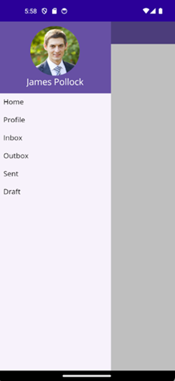

# Getting Started with .NET MAUI NavigationDrawer (SfNavigationDrawer)

This section provides a quick overview for working with the SfNavigationDrawer for .NET MAUI. Walk through the entire process of creating a real world of this control.

## Creating an application using the .NET MAUI Navigation Drawer
 1. Create a new .NET MAUI application in Visual Studio.
 2. Syncfusion .NET MAUI components are available on [nuget.org](https://www.nuget.org/). To add SfNavigationDrawer to your project, open the NuGet package manager in Visual Studio, search for Syncfusion.Maui.NavigationDrawer and then install it.

## Register the handler

To use this control inside an application, you must register the handler for Syncfusion® core.

**MauiProgram.cs**
```
using Microsoft.Extensions.Logging;
using Syncfusion.Maui.Core.Hosting;

namespace NavigationDrawerGettingStarted
{
    public static class MauiProgram
    {
        public static MauiApp CreateMauiApp()
        {
            var builder = MauiApp.CreateBuilder();
            builder
                .UseMauiApp<App>()
                .ConfigureSyncfusionCore()
                .ConfigureFonts(fonts =>
                {
                    fonts.AddFont("OpenSans-Regular.ttf", "OpenSansRegular");
                    fonts.AddFont("OpenSans-Semibold.ttf", "OpenSansSemibold");
                });

#if DEBUG
            builder.Logging.AddDebug();
#endif

            return builder.Build();
        }
    }
}

```

## Add a basic Navigation Drawer
1. Import the control namespace `Syncfusion.Maui.NavigationDrawer` in XAML or C# code.
2. Initialize the [SfNavigationDrawer](https://help.syncfusion.com/cr/maui/Syncfusion.Maui.Core.SfNavigationDrawer.html) control.

**XAML**
```
<ContentPage
    . . .    
    xmlns:navigationDrawer="clr-namespace:Syncfusion.Maui.NavigationDrawer;assembly=Syncfusion.Maui.NavigationDrawer">
    <navigationDrawer:SfNavigationDrawer x:Name="navigationDrawer">
    <navigationDrawer:SfNavigationDrawer.ContentView>
        <Grid/>
    </navigationDrawer:SfNavigationDrawer.ContentView>
    </navigationDrawer:SfNavigationDrawer>
</ContentPage>
```

**C#**
```
    using Syncfusion.Maui.NavigationDrawer;
    namespace NavigationDrawerGettingStarted
    {
        public partial class MainPage : ContentPage
        {
            public MainPage()
            {
                InitializeComponent();           
                SfNavigationDrawer navigationDrawer = new SfNavigationDrawer();
                Grid grid = new Grid();
                navigationDrawer.ContentView = grid;
                this.Content = navigationDrawer; 
            }
        }   
    }
```

## Set CollectionView as DrawerContentView

Create a Collection view with items and set it as [DrawerContentView](https://help.syncfusion.com/cr/maui/Syncfusion.Maui.NavigationDrawer.DrawerSettings.html#Syncfusion_Maui_NavigationDrawer_DrawerSettings_DrawerContentView). 

**XAML**
```
<navigationDrawer:SfNavigationDrawer x:Name="navigationDrawer">
    <navigationDrawer:SfNavigationDrawer.DrawerSettings>
        <navigationDrawer:DrawerSettings DrawerWidth="250"
                                 DrawerHeaderHeight="160">
            <navigationDrawer:DrawerSettings.DrawerHeaderView>
                <Grid BackgroundColor="#6750A4" RowDefinitions="120,40">
                    <Image Source="user.png"
                   HeightRequest="110"
                   Margin="0,10,0,0"
                   BackgroundColor="#6750A4"
                   VerticalOptions="Center"
                   HorizontalOptions="Center"/>
                    <Label Text="James Pollock"
                   Grid.Row="1"
                   HorizontalTextAlignment="Center"
                   HorizontalOptions="Center"
                   FontSize="20"
                   TextColor="White"/>
                </Grid>
            </navigationDrawer:DrawerSettings.DrawerHeaderView>
            <navigationDrawer:DrawerSettings.DrawerContentView>
                <CollectionView x:Name="collectionView" SelectionMode="Single"
                  SelectionChanged="collectionView_SelectionChanged">
                    <CollectionView.ItemsSource>
                        <x:Array Type="{x:Type x:String}">
                            <x:String>Home</x:String>
                            <x:String>Profile</x:String>
                            <x:String>Inbox</x:String>
                            <x:String>Outbox</x:String>
                            <x:String>Sent</x:String>
                            <x:String>Draft</x:String>
                        </x:Array>
                    </CollectionView.ItemsSource>
                    <CollectionView.ItemTemplate>
                        <DataTemplate>
                            <VerticalStackLayout HeightRequest="40">
                                <Label Margin="10,7,0,0"
                                   Text="{Binding}"
                                   FontSize="16"
                                   TextColor="Black"/>
                            </VerticalStackLayout>
                        </DataTemplate>
                    </CollectionView.ItemTemplate>
                </CollectionView>
            </navigationDrawer:DrawerSettings.DrawerContentView>
        </navigationDrawer:DrawerSettings>
    </navigationDrawer:SfNavigationDrawer.DrawerSettings>
    <navigationDrawer:SfNavigationDrawer.ContentView>
        <Grid x:Name="mainContentView" 
  BackgroundColor="White" RowDefinitions="Auto,*">
            <HorizontalStackLayout BackgroundColor="#6750A4" Spacing="10" Padding="5,0,0,0">
                <ImageButton x:Name="hamburgerButton"
                     HeightRequest="50"
                     WidthRequest="50"
                     HorizontalOptions="Start"
                     Source="hamburgericon.png"
                     BackgroundColor="#6750A4"
                     Clicked="hamburgerButton_Clicked"/>
                <Label x:Name="headerLabel" 
           HeightRequest="50" 
           HorizontalTextAlignment="Center" 
           VerticalTextAlignment="Center" 
           Text="Home" FontSize="16" 
           TextColor="White" 
           BackgroundColor="#6750A4"/>
            </HorizontalStackLayout>
            <Label Grid.Row="1" 
      x:Name="contentLabel" 
      VerticalOptions="Center" 
      HorizontalOptions="Center" 
      Text="Content View" 
      FontSize="14" 
      TextColor="Black"/>
        </Grid>
    </navigationDrawer:SfNavigationDrawer.ContentView>
</navigationDrawer:SfNavigationDrawer>
```

**C#**
```
namespace NavigationDrawerGettingStarted;

    public partial class MainPage : ContentPage
    {

        SfNavigationDrawer navigationDrawer;
        Label headerLabel;
        Label contentLabel;
        CollectionView collectionView;

        public MainPage()
        {
            InitializeComponent();

            // Drawer Header View
            var drawerHeader = new Grid
            {
                BackgroundColor = Color.FromArgb("#6750A4"),
                RowDefinitions = new RowDefinitionCollection
                {
                    new RowDefinition { Height = 120 },
                    new RowDefinition { Height = 40 }
                }
            };

            drawerHeader.Add(new Image
            {
                Source = "user.png",
                HeightRequest = 110,
                Margin = new Thickness(0, 10, 0, 0),
                BackgroundColor = Color.FromArgb("#6750A4"),
                VerticalOptions = LayoutOptions.Center,
                HorizontalOptions = LayoutOptions.Center
            });

            drawerHeader.Add(new Label
            {
                Text = "James Pollock",
                FontSize = 20,
                TextColor = Colors.White,
                HorizontalTextAlignment = TextAlignment.Center,
                HorizontalOptions = LayoutOptions.Center
            }, 0, 1);

            // Drawer Content View
            collectionView = new CollectionView
            {
                SelectionMode = SelectionMode.Single,
                ItemsSource = new string[] { "Home", "Profile", "Inbox", "Outbox", "Sent", "Draft" },
                ItemTemplate = new DataTemplate(() =>
                {

                    var label = new Label
                    {
                        Margin = new Thickness(10, 7, 0, 0),
                        FontSize = 16,
                        TextColor = Colors.Black
                    };
                    label.SetBinding(Label.TextProperty, ".");

                    return new VerticalStackLayout
                    {
                        HeightRequest = 40,
                        Children = { label }
                    };

                })
            };

            collectionView.SelectionChanged += collectionView_SelectionChanged;

            var drawerSettings = new DrawerSettings
            {
                DrawerWidth = 250,
                DrawerHeaderHeight = 160,
                DrawerHeaderView = drawerHeader,
                DrawerContentView = collectionView
            };

            // Main Content View
            headerLabel = new Label
            {
                Text = "Home",
                FontSize = 16,
                TextColor = Colors.White,
                BackgroundColor = Color.FromArgb("#6750A4"),
                HeightRequest = 50,
                HorizontalTextAlignment = TextAlignment.Center,
                VerticalTextAlignment = TextAlignment.Center
            };

            contentLabel = new Label
            {
                Text = "Content View",
                FontSize = 14,
                TextColor = Colors.Black,
                VerticalOptions = LayoutOptions.Center,
                HorizontalOptions = LayoutOptions.Center
            };

            var hamburgerButton = new ImageButton
            {
                Source = "hamburgericon.png",
                HeightRequest = 50,
                WidthRequest = 50,
                BackgroundColor = Color.FromArgb("#6750A4"),
                HorizontalOptions = LayoutOptions.Start
            };
            hamburgerButton.Clicked += hamburgerButton_Clicked;

            var topBar = new HorizontalStackLayout
            {
                BackgroundColor = Color.FromArgb("#6750A4"),
                Spacing = 10,
                Padding = new Thickness(5, 0, 0, 0),
                Children = { hamburgerButton, headerLabel }
            };

            var mainContent = new Grid
            {
                BackgroundColor = Colors.White,
                RowDefinitions = new RowDefinitionCollection
                {
                    new RowDefinition { Height = GridLength.Auto },
                    new RowDefinition { Height = GridLength.Star }
                }
            };
            mainContent.Add(topBar);
            mainContent.Add(contentLabel, 0, 1);

            // Navigation Drawer
            navigationDrawer = new SfNavigationDrawer
            {
                DrawerSettings = drawerSettings,
                ContentView = mainContent
            };

            Content = navigationDrawer;
        }
    }

```

**C#**
```
        private void hamburgerButton_Clicked(object sender, EventArgs e)
        {
            navigationDrawer.ToggleDrawer();
        }

        private void collectionView_SelectionChanged(object sender, SelectionChangedEventArgs e)
        {
            if (e.CurrentSelection.FirstOrDefault() is string selectedItem)
            {
                headerLabel.Text = selectedItem;
                contentLabel.Text = $"{selectedItem} Content";
                navigationDrawer.ToggleDrawer();
            }
        }

```

Run the application to render the following output:



## <a name="troubleshooting"></a>Troubleshooting ##
### Path too long exception
If you are facing path too long exception when building this example project, close Visual Studio and rename the repository to short and build the project.

## License

Syncfusion has no liability for any damage or consequence that may arise by using or viewing the samples. The samples are for demonstrative purposes, and if you choose to use or access the samples, you agree to not hold Syncfusion liable, in any form, for any damage that is related to use, for accessing, or viewing the samples. By accessing, viewing, or seeing the samples, you acknowledge and agree Syncfusion’s samples will not allow you seek injunctive relief in any form for any claim related to the sample. If you do not agree to this, do not view, access, utilize, or otherwise do anything with Syncfusion’s samples.